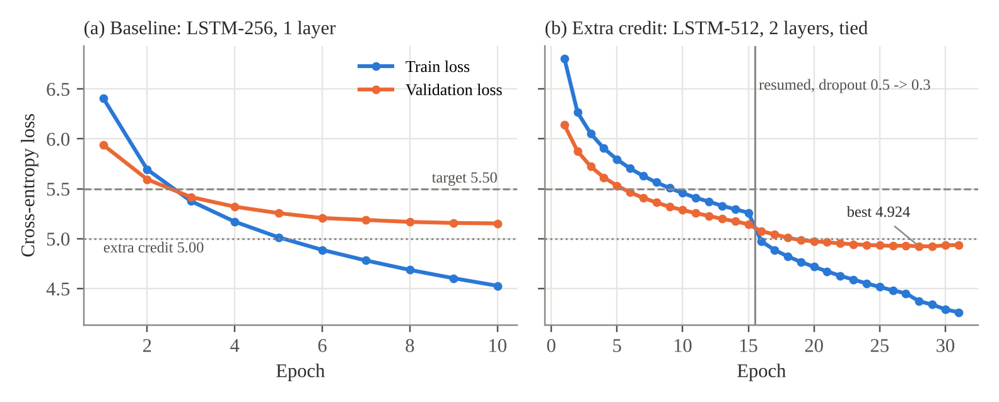
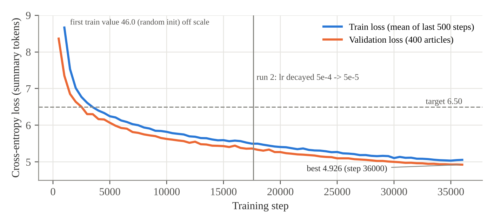
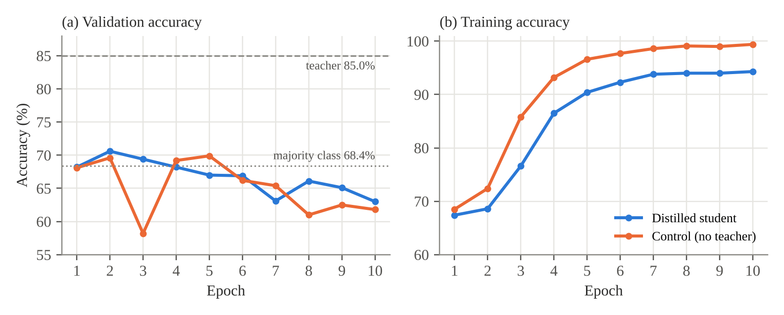

# Neural Text Processing: LSTM Language Model, Transformer Summarizer and TinyBERT Distillation

An LSTM language model that generates tech-news headlines, a Transformer implemented from scratch for news summarization, and BERT-base distilled into a 7.6× smaller TinyBERT student.

All models were written in **PyTorch** and trained on a **Google Colab T4 GPU**.

**Results**
| Part | Task | Model | Result |
|---|---|---|---|
| 1 | Headline generation (language modeling) | 2-layer LSTM-512, tied embeddings | validation loss **4.92** |
| 2 | News summarization | Transformer (6 + 6 layers) implemented from scratch | validation loss **4.93** |
| 3 | Knowledge distillation | BERT-base (110M) → TinyBERT-4 (14.4M) | MRPC accuracy: teacher **85.0%**, student **70.6%**, control 69.9% |

---

## Part 1: LSTM language model for headline generation

**Data and task:** The model is trained on 88,568 technology-news headlines and learns to predict each word from the words before it.

**Implementation**
- Batches built with right-shifted inputs and a padding mask.
- A cross-entropy loss that ignores padding tokens.
- An LSTM model (`language_model.py`) with optional weight tying.

**Tuning:** The baseline LSTM-256 reached a validation loss of 5.15. Two changes brought it down to **4.92**:
- More capacity: 2 layers of 512 units, with input and output embeddings tied.
- Dropout lowered from 0.5 to 0.3, after the training curves showed the model was underfitting.



**Example headlines generated by the model (greedy decoding)**
- *microsoft to buy* → "microsoft to buy linkedin for $ 26.2 billion in cash …" (the real acquisition price)
- *amazon* → "amazon to open first physical store in nyc …"
- *apple has released* → "apple has released a new version of the iphone x - and it could be a big deal for …"

## Part 2: Transformer for news summarization

**Implementation:** Every Transformer building block is implemented from scratch:
- scaled dot-product attention;
- multi-head split and combine;
- sinusoidal position embeddings;
- pre-norm encoder and decoder blocks;
- the full encoder–decoder model (`transformer.py`, `transformer_attention.py`).

All blocks match the reference outputs to float32 precision.

**Training:** The model was trained on 61,055 police-news article and summary pairs, with a learning-rate warm-up followed by a linear decay. Validation loss: **4.93**.



**Bugs found and fixed**
- The loss used `reduce='none'` instead of `reduction='none'`, so padding tokens were included in the average.
- The greedy decoding loop added the start token twice, so every generated word was repeated.

## Part 3: Knowledge distillation (TinyBERT)

**Implementation:** The TinyBERT losses are in `kd_loss.py`: embedding, attention, hidden-state and soft-prediction losses, combined with a 3m layer mapping.

**Experiment**
  Fine-tuned BERT-base as the teacher on Wikitext-2 and on MRPC.
  Distilled the teacher into a 4-layer, 312-dimensional student.
  Compared the student with a control model of the same size trained without a teacher.

**Findings**
Switching the teacher's optimizer from **Adam with weight decay** to **AdamW** improved its masked-LM loss from 2.61 to 1.78.
The distilled student overfits less than the control (94% vs. 99% training accuracy).



---

## Repository structure
1 Language Modeling.ipynb        Part 1 notebook (with outputs)
2 Summarization.ipynb            Part 2 notebook (with outputs)
3 Knowledge Distillation.ipynb   Part 3 notebook (with outputs)
language_model.py                LSTM language model
transformer_attention.py         attention and multi-head attention
transformer.py                   position embedding, encoder/decoder blocks, Transformer
kd_loss.py                       TinyBERT distillation losses
transformer_utils.py, utils.py, capita.py   helper code (see Acknowledgements)
figures/                         training curves and result plots
```

## How to run
1. Open a notebook in Google Colab and select a GPU runtime.
2. Put the repository files in a Google Drive folder, then set `root_folder` in the first ("Quick Setup") cell.
3. Notebooks 1 and 2 need the headline and news-summarization datasets, which are not included in this repository. Notebook 3 downloads BERT, Wikitext-2 and MRPC from Hugging Face automatically.

## Acknowledgements
The project skeleton and helper code (`utils.py`, `transformer_utils.py`, `capita.py`) are adapted from the UC Berkeley CS182 course materials on deep learning for NLP.

**Author:** Ammara Khan
